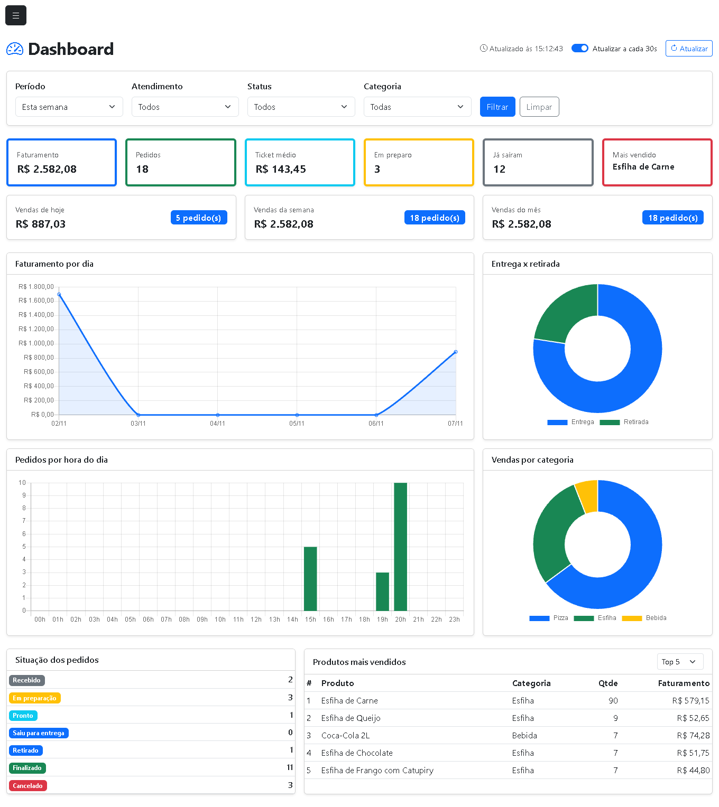
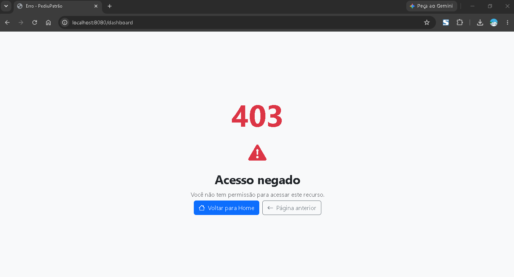
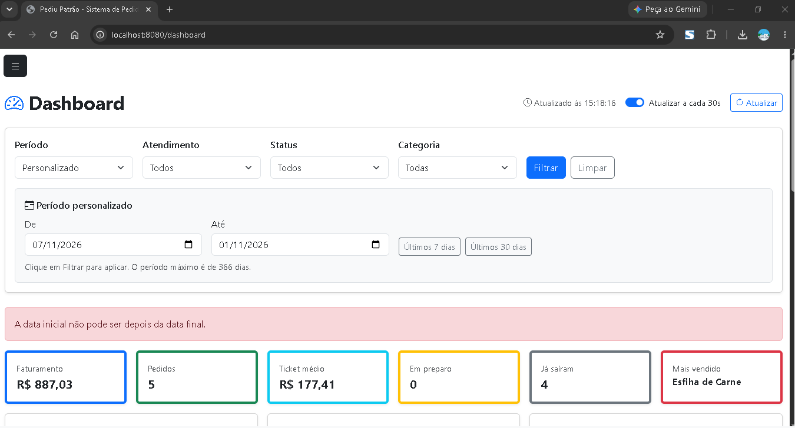
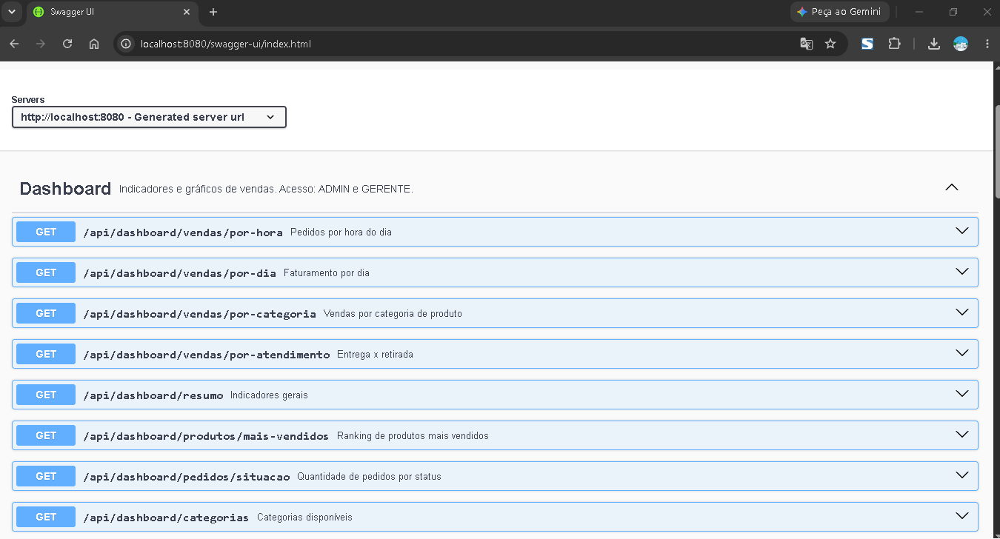
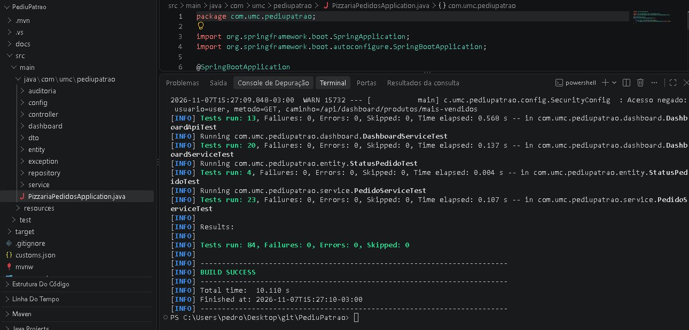

# Evidências de testes: Dashboard Administrativo

## 1. Ambiente

| Item | Valor |
|---|---|
| Data da execução | 02/11/2026 e 07/11/2026 |
| Java | 21.0.2 |
| Spring Boot | 3.4.4 |
| Banco | MongoDB Atlas (banco `pizzaria`) |
| Usuários usados | `admin` (ADMIN), `gerencia` (GERENTE), `balcao` (ATENDENTE) |

## 2. Testes automatizados

Comando: `./mvnw test`. Não dependem do Atlas (usam mocks e `@WebMvcTest`).

| Classe | Testes | Falhas | Foco |
|---|---:|---:|---|
| `DashboardServiceTest` | 20 | 0 | Cálculos, filtros e validações do dashboard |
| `DashboardApiTest` | 13 | 0 | Permissões e erros HTTP dos endpoints |
| `PermissoesApiTest` | 19 | 0 | Permissões da API de pedidos, auditoria e usuários (já existia) |
| `PedidoServiceTest` | 23 | 0 | Regras de pedido e ordem da listagem |
| `AuditoriaServiceTest` | 5 | 0 | Auditoria (já existia) |
| `StatusPedidoTest` | 4 | 0 | Fluxo de status (já existia) |
| **Total** | **84** | **0** | `BUILD SUCCESS` |

### Casos do dashboard por requisito

| Requisito | Cenário | Teste | Resultado |
|---|---|---|---|
| RF01 | Resumo de hoje ignora pedido cancelado e calcula pedidos, faturamento, ticket médio, em preparo, já saíram e mais vendido | `resumoDeHojeIgnoraPedidoCancelado` | Aprovado |
| RF01 | Totais fixos de hoje, semana (segunda a hoje) e mês | `resumoTrazTotaisFixosDeHojeSemanaEMes` | Aprovado |
| RF01 | Totais fixos não mudam quando o filtro muda | `totaisFixosNaoMudamQuandoOFiltroMuda` | Aprovado |
| RF01 | Período sem pedidos devolve zeros e produto mais vendido nulo | `resumoSemPedidosNaoQuebraENaoTemProdutoMaisVendido` | Aprovado |
| RF02 | Faturamento por dia inclui dias sem venda | `faturamentoPorDiaIncluiDiasSemVenda` | Aprovado |
| RF02 | Pedidos por hora: 24 pontos, agrupados pela hora de entrada | `pedidosPorHoraTem24PontosEAgrupaPelaHoraDeEntrada` | Aprovado |
| RF02 | Vendas por categoria somam o faturamento | `vendasPorCategoriaSomamOFaturamentoDoPeriodo` | Aprovado |
| RF02 | Categoria considera o desconto do pedido e ignora maiúsculas | `categoriaConsideraODescontoDoPedido` | Aprovado |
| RF02 | Entrega e retirada sempre voltam as duas opções | `entregaERetiradaSempreVoltamAsDuasOpcoes` | Aprovado |
| RF03 | Situação conta todos os status, inclusive cancelado | `situacaoDosPedidosContaTodosOsStatusInclusiveCancelado` | Aprovado |
| RF04 | Ranking ordenado por quantidade, limitado e com faturamento | `rankingOrdenaPorQuantidadeELimitaOResultado` | Aprovado |
| RF04 | Ranking filtrado por categoria | `rankingPodeSerFiltradoPorCategoria` | Aprovado |
| RF05 | Filtro por status | `filtraPorStatus` | Aprovado |
| RF05 | Categorias do filtro vêm dos produtos, sem repetição e em ordem alfabética | `categoriasVemDosProdutosSemRepetirEmOrdemAlfabetica` | Aprovado |
| RF05 | Período personalizado tem prioridade sobre o período fixo | `periodoPersonalizadoTemPrioridadeSobreOPeriodoFixo` | Aprovado |
| RF05 / RF07 | Início depois do fim, só uma data, período maior que 366 dias e limite fora de 1–20 são recusados | `dataInicialDepoisDaFinalEhRecusada`, `informarSoUmaDataEhRecusado`, `periodoMuitoLongoEhRecusado`, `limiteDoRankingForaDaFaixaEhRecusado` | Aprovado |
| RF07 | Pedido antigo sem itens e sem total não quebra os cálculos | `pedidoAntigoSemItensENemTotalNaoQuebraOsCalculos` | Aprovado |
| RF06 / RNF01 | GERENTE e ADMIN acessam todos os 8 endpoints | `gerenteAcessaTodosOsEndpoints`, `adminAcessaTodosOsEndpoints` | Aprovado |
| RNF01 | ATENDENTE recebe 403 em todos os endpoints e na documentação da API | `atendenteNaoAcessaNenhumEndpoint`, `atendenteNaoAcessaADocumentacaoDaApi` | Aprovado |
| RNF01 | Sem login redireciona para o login | `semLoginRedirecionaParaOLogin` | Aprovado |
| RNF01 | Dashboard só aceita leitura | `dashboardSoAceitaLeitura` | Aprovado |
| RF07 | Data inválida, status inválido, atendimento inválido e limite não numérico devolvem 400 | `dataEmFormatoInvalidoDevolve400`, `statusDesconhecidoDevolve400`, `tipoDeAtendimentoDesconhecidoDevolve400`, `limiteQueNaoEhNumeroDevolve400` | Aprovado |
| RF07 | Erro de regra de filtro vira 400 com a mensagem | `regraDeFiltroDoServicoViraErro400ComMensagem`, `limiteInvalidoDoRankingViraErro400` | Aprovado |
| RF07 | Lista vazia volta como `[]` | `listasVaziasSaoDevolvidasComoArrayVazio` | Aprovado |

## 3. Testes manuais da API (aplicação rodando com o Atlas)

Executados com `curl`, com login por formulário e cookie de sessão de cada usuário.

### 3.1 Permissões

| Requisição | Usuário | Esperado | Obtido |
|---|---|---|---|
| `GET /api/dashboard/resumo` | `gerencia` (GERENTE) | 200 | 200 |
| `GET /api/dashboard/resumo` | `admin` (ADMIN) | 200 | 200 |
| `GET /api/dashboard/resumo` | `balcao` (ATENDENTE) | 403 | 403 |
| `GET /api/dashboard/resumo` | sem login | 302 para o login | 302 |
| `GET /v3/api-docs` | `gerencia` | 200 | 200 |
| `GET /v3/api-docs` | `balcao` | 403 | 403 |
| `GET /dashboard` (tela) | `gerencia` | 200 | 200 |
| `GET /dashboard` (tela) | `balcao` | 403 | 403 |

### 3.2 Endpoints com dados reais

Todos os endpoints responderam 200 para o GERENTE. As respostas completas, com os valores obtidos, estão em `docs/api-endpoints.md`. Período consultado: de 31/10/2026 a 02/11/2026. Os pedidos de teste foram registrados em 02/11/2026, e os dois dias anteriores ficam sem venda de propósito, para conferir que a API devolve todos os dias do período.

| Endpoint | Resultado obtido |
|---|---|
| `/resumo` | 13 pedidos, faturamento R$ 1.695,05, ticket médio R$ 130,39, 3 em preparo, 8 já saíram, mais vendido "Esfiha de Carne" |
| `/vendas/por-dia` | 31/10: 0 pedidos. 01/11: 0 pedidos. 02/11: 13 pedidos, R$ 1.695,05 |
| `/vendas/por-hora` | 24 itens. 19h: 3 pedidos, R$ 331,40. 20h: 10 pedidos, R$ 1.363,65 |
| `/vendas/por-categoria` | Pizza: 12 pedidos, R$ 1.383,12. Esfiha: 5 pedidos, R$ 170,05. Bebida: 10 pedidos, R$ 141,88 |
| `/vendas/por-atendimento` | Entrega: 9 pedidos, R$ 1.230,15. Retirada: 4 pedidos, R$ 464,90 |
| `/pedidos/situacao` | Recebido 1, Em preparação 3, Pronto 1, Retirado 1, Finalizado 7, Cancelado 2 |
| `/produtos/mais-vendidos` | Esfiha de Carne (10), Coca-Cola 2L (6), Esfiha de Queijo (6) |

Conferências cruzadas:
- Por dia: o único dia com venda (02/11) tem o mesmo faturamento do resumo, R$ 1.695,05.
- Por hora: R$ 331,40 + R$ 1.363,65 = R$ 1.695,05, e 3 + 10 = 13 pedidos.
- Entrega + retirada: R$ 1.230,15 + R$ 464,90 = R$ 1.695,05 = faturamento do resumo e dos totais de hoje, semana e mês.
- Pizza + esfiha + bebida: R$ 1.383,12 + R$ 170,05 + R$ 141,88 = R$ 1.695,05. O valor de cada categoria já considera o desconto do pedido, por isso a soma bate com o faturamento.
- Situação: 1 + 3 + 1 + 1 + 7 = 13 vendas, mais 2 cancelados que não entram no faturamento.
- Filtro `tipoAtendimento=ENTREGA`: 9 pedidos e R$ 1.230,15, igual à entrega do gráfico de entrega × retirada.

### 3.3 Erros de filtro

| Requisição | Esperado | Obtido |
|---|---|---|
| `/resumo?inicio=2026-11-02&fim=2026-10-31` | 400 | 400: "A data inicial não pode ser depois da data final." |
| `/resumo?inicio=2026-10-31` (sem `fim`) | 400 | 400: "Informe as duas datas, inicio e fim." |
| `/resumo?inicio=31/10/2026&fim=02/11/2026` (formato errado) | 400 | 400: "Valor inválido para o parâmetro 'inicio'." |
| `/resumo?inicio=2026-10-31&fim=2026-11-02&status=XYZ` | 400 | 400: "Valor inválido para o parâmetro 'status'." |
| `/resumo?inicio=2025-10-31&fim=2026-11-02` (mais de 366 dias) | 400 | 400: "O período máximo de consulta é de 366 dias." |
| `/produtos/mais-vendidos?inicio=2026-10-31&fim=2026-11-02&limite=99` | 400 | 400: "O limite deve ficar entre 1 e 20." |

### 3.4 Teste da semana e prints

Em 07/11/2026 foram registrados mais 6 pedidos pelo usuário `balcao`: 4 finalizados, 1 com desconto de 15% aplicado pelo `gerencia` e 1 cancelado pelo `gerencia` com justificativa. Assim a semana passou a ter vendas em dois dias.

Resultado no dashboard com o período "Esta semana", de 02/11 a 07/11/2026:

| Indicador | Valor |
|---|---|
| Faturamento | R$ 2.582,08 |
| Pedidos | 18 |
| Ticket médio | R$ 143,45 |
| Em preparo | 3 |
| Já saíram | 12 |
| Mais vendido | Esfiha de Carne |
| Vendas de hoje | 5 pedidos, R$ 887,03 |

Conferências:
- 02/11 com R$ 1.695,05 mais 07/11 com R$ 887,03 dá R$ 2.582,08, igual ao faturamento da semana.
- Hoje foram registrados 6 pedidos, mas só 5 contam como venda, porque 1 foi cancelado.
- Situação dos pedidos: 2 recebidos, 3 em preparação, 1 pronto, 1 retirado e 11 finalizados somam as 18 vendas. Os 3 cancelados aparecem só nessa consulta.

**Dashboard com o período da semana**

**Atendente tentando abrir o dashboard: acesso negado**

**Filtro com data inicial depois da final: mensagem de erro na tela**

**Endpoints do dashboard no Swagger**

**Testes automatizados: 84 testes, nenhuma falha**

## 4. Limitações conhecidas

- Os valores dependem dos pedidos que estão no banco no momento do teste. Os números das seções 3.2 e 3.3 são de 02/11/2026, os da seção 3.4 são de 07/11/2026, e mudam conforme novos pedidos são registrados ou têm o status alterado. Os pedidos mais antigos do banco são de 13/10 e 14/10/2026 e ficam fora do período usado nos exemplos.
- A lista de categorias do filtro da tela vem dos produtos cadastrados (`/api/dashboard/categorias`). Os dados de teste foram cadastrados em 02/11/2026: 24 produtos (10 pizzas, 9 bebidas e 5 esfihas) e 10 clientes. Os pedidos de teste foram registrados em 02/11 e 07/11/2026, por isso o gráfico por dia mostra venda nesses dois dias e zero nos dias entre eles.
