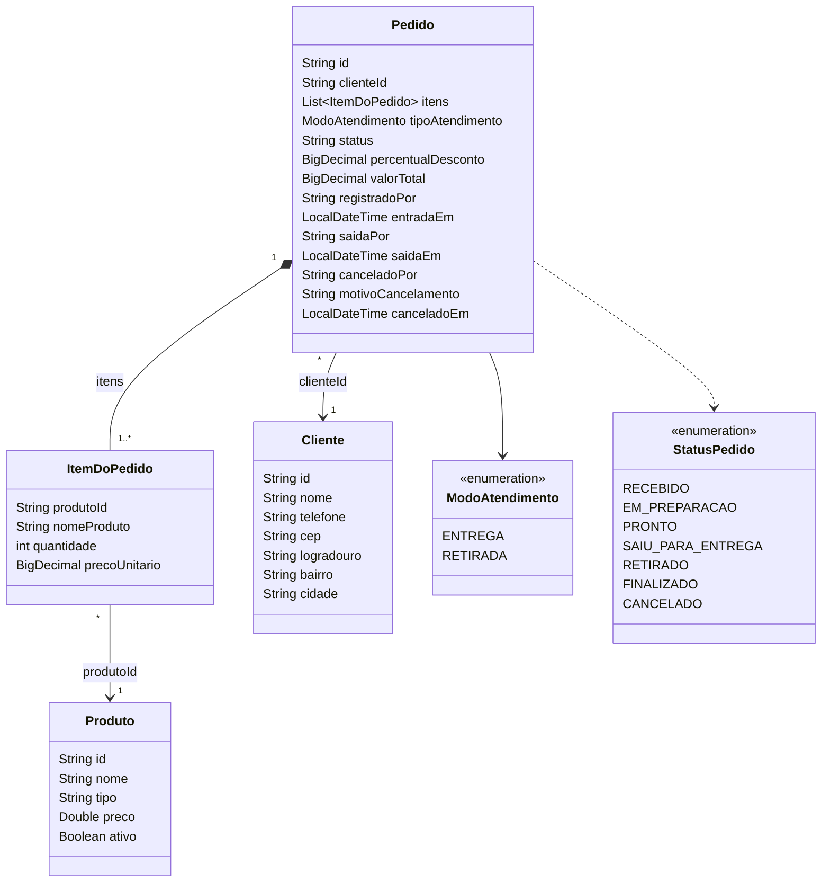

# Dashboard Administrativo: requisitos

Painel para o responsável pela pizzaria acompanhar vendas, pedidos e tendências, alimentado por uma API própria em `/api/dashboard`.

## Requisitos funcionais

| ID | Requisito | Critério de aceite |
|---|---|---|
| RF01 | Indicadores gerais de vendas | Mostrar pedidos, faturamento, ticket médio, pedidos em preparo, pedidos que já saíram e produto mais vendido. Mostrar também os totais fixos de hoje, da semana e do mês. |
| RF02 | Análise de vendas (gráficos) | Faturamento por dia (linha), pedidos por hora do dia (barras), vendas por categoria (rosca) e entrega × retirada (rosca). |
| RF03 | Situação dos pedidos | Quantidade de pedidos por status, incluindo cancelados. |
| RF04 | Produtos mais vendidos | Ranking por quantidade, com faturamento de cada produto e limite configurável (1 a 20). |
| RF05 | Filtros de consulta | Período (hoje, semana, mês ou datas personalizadas), tipo de atendimento, status e categoria. Todos os indicadores, gráficos e o ranking respeitam os filtros. |
| RF06 | Integração com a API | O dashboard obtém todos os dados pelos endpoints, sem acessar o banco diretamente. |
| RF07 | Atualização e tratamento de dados | Atualização dos dados sem recarregar a página, com indicação de carregamento, de ausência de dados e de erro. Filtros inválidos devolvem mensagem clara. |

## Requisitos não funcionais

| ID | Requisito |
|---|---|
| RNF01 | **Segurança:** somente ADMIN e GERENTE acessam o dashboard, a API de métricas e a documentação da API. A regra é aplicada no backend (Spring Security) e as respostas não trazem dados pessoais de clientes. |
| RNF02 | **Desempenho:** a consulta ao MongoDB busca apenas o intervalo de datas pedido, e o período máximo de consulta é de 366 dias. |
| RNF03 | **Confiabilidade:** pedidos antigos sem itens, sem total ou com status desconhecido não quebram os cálculos. |
| RNF04 | **Usabilidade:** layout responsivo, no mesmo padrão visual do restante do sistema (Bootstrap 5). |
| RNF05 | **Manutenibilidade:** código em camadas (controller, service, repositório) e em pacote próprio, `dashboard`, como já é feito na auditoria. |
| RNF06 | **Testabilidade:** regras de cálculo e permissões cobertas por testes automatizados que não dependem do banco. |
| RNF07 | **Documentação:** endpoints documentados no Swagger (`/swagger-ui.html`) e neste diretório. |

## Regras de negócio das métricas

1. **Venda** é todo pedido com status diferente de `CANCELADO`. Só vendas entram em faturamento, ticket médio, gráficos e ranking.
2. **Faturamento** é a soma do `valorTotal` dos pedidos, que já está com o desconto aplicado.
3. **Ticket médio** é o faturamento dividido pelo número de vendas. Sem vendas, é zero.
4. **Em preparo** são os pedidos em `EM_PREPARACAO`.
5. **Já saíram** são os pedidos em `SAIU_PARA_ENTREGA`, `RETIRADO` ou `FINALIZADO`.
6. **Situação dos pedidos** é a única consulta que inclui os cancelados.
7. **Data do pedido** é a data de entrada (`entradaEm`). Pedidos sem essa data ficam fora das consultas.
8. **Fuso horário:** Brasília (`America/Sao_Paulo`). "Hoje" é o dia atual nesse fuso.
9. **Semana** vai da segunda-feira até hoje. **Mês** vai do dia 1 até hoje.
10. **Período personalizado** exige as duas datas, com início menor ou igual ao fim. Se for informado, vale mais que o período fixo.
11. **Categoria** é o tipo do produto cadastrado (hoje: Pizza, Esfiha e Bebida; o filtro da tela lista os tipos que existem no cadastro). Item de produto que não existe mais fica em "Outros".
12. **Valor por categoria e por produto** usa o subtotal do item com o desconto do pedido, para que a soma bata com o faturamento.
13. **Filtro de categoria** mantém apenas os pedidos que têm itens daquela categoria. Os gráficos de categoria e o ranking mostram só esses itens.
14. **Totais fixos** de hoje, semana e mês (no resumo) não são afetados pelos filtros.

## Endpoints previstos

Todos usam `GET`, aceitam os filtros `periodo`, `inicio`, `fim`, `tipoAtendimento`, `status` e `categoria`, e exigem perfil ADMIN ou GERENTE.

| Endpoint | Requisito |
|---|---|
| `/api/dashboard/categorias` | RF05 (opções do filtro de categoria) |
| `/api/dashboard/resumo` | RF01 |
| `/api/dashboard/vendas/por-dia` | RF02 |
| `/api/dashboard/vendas/por-hora` | RF02 |
| `/api/dashboard/vendas/por-categoria` | RF02 |
| `/api/dashboard/vendas/por-atendimento` | RF02 |
| `/api/dashboard/pedidos/situacao` | RF03 |
| `/api/dashboard/produtos/mais-vendidos` (parâmetro extra `limite`) | RF04 |

A documentação detalhada, com exemplos de requisição e resposta, fica em `docs/api-endpoints.md`.

## Modelo de dados

O dashboard lê três coleções do MongoDB: `pedidos`, `produtos` e `clientes`. Os itens não têm coleção própria, eles ficam guardados dentro de cada pedido.

Como o dashboard usa cada parte:

- **Pedido:** `entradaEm` define o dia e a hora da venda, `valorTotal` entra no faturamento, `status` separa vendas de cancelados e `tipoAtendimento` alimenta o gráfico de entrega e retirada.
- **ItemDoPedido:** guarda o preço do produto no momento da venda. Se o preço mudar depois, o histórico não muda.
- **Produto:** o campo `tipo` vira a categoria nos gráficos e no filtro.
- **Cliente:** fica fora das respostas do dashboard, porque o painel não precisa de dados pessoais.

## Decisões de projeto

| Decisão | Motivo |
|---|---|
| Um endpoint para cada bloco do painel | Cada card e gráfico carrega sozinho. Se um falhar, os outros continuam aparecendo, e a API pode ser usada por outro sistema no futuro. |
| Cálculos feitos no service, em Java | O MongoDB devolve só os pedidos do período e o service faz as contas. Assim as regras ficam num lugar só e dá para testar sem banco. |
| Período máximo de 366 dias | Evita que uma consulta muito grande traga todos os pedidos de uma vez e deixe o sistema lento. |
| Venda é todo pedido que não foi cancelado | Pedido cancelado não gerou dinheiro, então não pode entrar no faturamento. Ele aparece só na situação dos pedidos. |
| Fuso horário de Brasília | O servidor pode estar em outro fuso. Sem isso, um pedido feito às 22h poderia contar no dia seguinte. |
| Desconto distribuído entre os itens | O desconto é do pedido inteiro, mas os gráficos mostram valores por categoria e por produto. Distribuindo o desconto, a soma das categorias fica igual ao faturamento. |
| Categorias vêm do cadastro de produtos | Se a pizzaria cadastrar um tipo novo, como Lanche, ele aparece no filtro sem mudar o código. |
| Valores em BigDecimal | Evita erros de arredondamento nos centavos, que acontecem com double. |
| Atualização automática a cada 30 segundos | O painel fica atualizado sem recarregar a página, e para de atualizar quando a aba não está aberta, para não fazer chamadas à toa. |
| Acesso só para ADMIN e GERENTE | São os perfis que acompanham o negócio. As respostas não trazem nome, telefone nem endereço de cliente, porque o painel não precisa disso. |